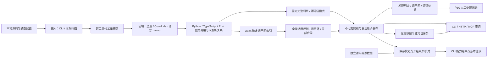

# 全项目调用结构完整性分析系统

文档版本：v1.1，补充 v0.15 语言接入。实现名称：CallScope v0.15.0。默认 `all` 选择 38 个规范语言/格式 ID，保留原三套前端并直接复用固定 CodeGraph 新语言结构提取。v0.14 scope2 的[核心与策略冻结](../reports/astra-iteration12-scope2/CORE_FREEZE.json)、两库正常冷/热静态报告与[原有限内容正式读回](../reports/astra-iteration12-scope2/ORIGINAL_REPORT_COMPLETION.md)保持历史身份；complete=true 只限该版已读有限内容，不证明新语言验证、全程序功能、运行成功或超越原全文。

v0.15 使用分析器 `static-multilang-15-codegraph`，检测器仍为 `call-rules-13-architecture-explanations`，schema 2。CodeGraph 固定提交为 `8f1f842b5b828175992d2ce2cdf673b955b2cce9`，保存 323 份来源文件及 31 份压缩语法/32 映射，工具运行要求 Node.js 20–24。完整目录、来源与候选/元数据层级见 [CODEGRAPH_REUSE.md](CODEGRAPH_REUSE.md)。下文 v0.14 及更早结果不因新增注册而重新验收。

## 1. 目标与判断边界

系统持续维护项目的静态调用结构，并关联有限源码合同、版本变化和原文证据。它回答明确连接、初始化集合、封闭字段构造及有限参数来源形式是否满足声明，并保留解析不足、模型前提和外部适用条件。

目标以原始 [CodePatchBay 全文报告](../reports/astra-baseline/CODEPATCHBAY_ANALYSIS.md)和 [WinWinCode 全文报告](../reports/astra-baseline/WINWINCODE_ANALYSIS.md)为固定基准：自动分析需要覆盖主链、架构边界、条件、反证及未审范围，不设置重复 Astra 审批。五项判断/30必要义务是实现追踪，见 [原合同](../reports/astra-iteration4/GOAL_ACCEPTANCE.md)；它们与调用10/10、Finding数量均不是全文报告分母。

v0.12 在字段不可变IR、局部预算和有限装配分析之上，增加五种固定完整判断适配器和八类源码链模式。源选择器只定位声明，事实和中间关系由保存AST/CALLS产生；注册层核对完整必要证据和模型适用性。项目报告按保存证据生成结构、完整条件判断、主要功能链与未闭合范围，明确不声明已复现全文报告。v0.11 的源码结构轴与当前 copy 终点见证作为独立局部证据保留，不因新增报告改变入口字段、运行值或一般运输结论。

v0.13 在上述协议上新增八种源码关系类型，分别处理有限 Rust 状态选择、条件门、事件到索引投影、可信命令来源、unsupported 记录保留、消息/记录身份、浏览器异步生命周期及资源写者来源。它们从已认证保存 CST、词法声明、字段/记录、现有调用绑定和显式模型生成关系，不把完整分析降成调用路径是否存在，也不将任意字段流、一般 heap、全领域状态机或执行结果纳入承诺。分析器为 `static-multilang-13`，检测器为 `call-rules-12-report-relations`，schema 保持 2。

v0.14 保留这些关系，并增加条件式状态沿袭、发布边界和文档部署对照。它将实际记录构造、字段写入、已绑定参数交接、拒绝 guard、return 与正常源码顺序组织为职责解释，而不是按目录或函数名填写职责。报告使用 `captured-project-analysis-report-3`，该版分析器为 `static-multilang-14`、检测器为 `call-rules-13-architecture-explanations`，快照 schema 为 2。

条件式状态沿袭把实际状态谓词、事件字面字段与后续 queue 入参中的旧任务来源连接起来；发布分析区分源码模式/布尔 opt-in、真实提前返回、选项到 callee 形参的绑定以及 opaque transport。未知 spread 后的覆盖、未识别对象成员、局部状态与嵌套分支不补成已知前缀条件。它不把源码先后顺序写成回调激活、必然入队、授权成功或远端发布成功。

文档部署对照读取快照显式捕获的文档和所选 Rust 来源。有限条款模型保留标题、段落、否定、引述和部署限定，把 Control Plane 内部唯一、Device 本地 provider/凭据字节材料、Worker 模型流分支分别呈现。材料不是凭据引用，字节容器不能证明凭据长期性，本地消费分支不能证明绕过 ExecutionPort 协议。正式文档比较及职责解释已保存在 scope2 报告；原 14 行职责、十主链领域和文档三方面已完成实际正文与来源对照，不由所选关系数量推定。

v0.14 历史正式来源见 [CPB 报告](../reports/astra-iteration12-scope2/codepatchbay-automatic-report.md)与 [WWC 报告](../reports/astra-iteration12-scope2/winwincode-automatic-report.md)，可从 [CPB 摘要](../reports/astra-iteration12-scope2/codepatchbay-analysis-summary.md)、[WWC 摘要](../reports/astra-iteration12-scope2/winwincode-analysis-summary.md)开始阅读。CPB 保存三判断/18 必要关系及 16 条所选支持链，WWC 为两判断/12 必要关系及 20 条所选支持链；职责操作为 15,223 与 10,023，共享引用检查失败均为 0。两库快照范围仍 partial，这些数量不是功能覆盖率。

[原 26 观察比较](../reports/astra-iteration12-scope2/ORIGINAL_BASELINE_COMPARISON.json)保持 10 reproduced/3 unknown/13 evidence_only、changes=[]；[发布身份](../reports/astra-iteration12-scope2/PUBLICATION_IDENTITY.json)verified=true，65 份核心与冻结身份一致。[原报告有限内容的完成读回](../reports/astra-iteration12-scope2/ORIGINAL_REPORT_COMPLETION.md)单独保存 complete=true，依据是实际正文及来源对照，不由这些身份核对或计数自动授予。

[正常 CLI 报告读回](../reports/astra-iteration12-scope2/CLI_REPORT_READBACK.json)确认 WWC Markdown 与正式报告逐字节一致、数据库逻辑行/schema/身份保持且未重扫。普通 Store 初始化后的数据库物理字节变化另有记录，不能称为物理文件完全未变。

以下 v0.13/v0.12 段落是已完成的历史正式记录，不是 v0.14 的结果。

v0.13 正式保存的 [CodePatchBay 报告](../reports/astra-iteration11/codepatchbay-automatic-report.md)与 [WinWinCode 报告](../reports/astra-iteration11/winwincode-automatic-report.md)分别有13与18条所选链，状态均为 `scoped_source_relations_supported`。WWC 旧三条 partial 的 crate 属性绑定误判已解除，source-only、generic 端口、外部效果和资源 partial ownership 边界没有被抹去。31条是所选源码链/关系数量，不是全文覆盖率或31个功能通过。

[CPB integration](../reports/astra-iteration11/codepatchbay-integration.json)与 [WWC integration](../reports/astra-iteration11/winwincode-integration.json)记录 v0.13 的 `full` 引擎冷/热重算：各库同 ID、created=true/false，前端和检测均重算，不声称缓存复用。解析330/333、465/471，快照均 partial；源码 hash 与 v0.12 相同，策略/工具/引擎身份不同，不当作同引擎精度或性能比较。

[原26项比较](../reports/astra-iteration11/ORIGINAL_BASELINE_COMPARISON.json)保持10 reproduced/3 unknown/13 evidence_only，两库 changes=[]；36份原引用的保存/现场 hash 及冻结 commit 匹配。[发布身份](../reports/astra-iteration11/PUBLICATION_IDENTITY.json) verified=true，共享组件一致，60份当前/存档核心一致。它们是可追溯身份及原观察的核对，不是全项目功能无回退证明，也不是新增模型审批。

[正式判断账本](../reports/astra-iteration11/goal-ledger.json)与 [判断证据](../reports/astra-iteration11/GOAL_JUDGMENT_EVIDENCE.json)已编译保存五项 `scoped_static_judgment_reproduced`、30项 supported 和704项真实引用。[正常 CLI 报告导出](../reports/astra-iteration11/CLI_REPORT_READBACK.json)核对 WWC 导出与正式 Markdown 字节/hash 一致、保存数据逻辑/schema/身份保持，未重扫。结果入口见 [CPB摘要](../reports/astra-iteration11/codepatchbay-analysis-summary.md)、[WWC摘要](../reports/astra-iteration11/winwincode-analysis-summary.md)和 [发布说明](../reports/astra-iteration11/REPORT.md)；[全文范围差距](../reports/astra-iteration11/REPORT_SCOPE_GAPS.md)与 [条目导航](../reports/astra-iteration11/REPORT_ALIGNMENT_RESULTS.json)保留原完整报告中已承接、有限承接及未审的区别。

v0.12 正式结果见 [CodePatchBay摘要](../reports/astra-iteration10/codepatchbay-analysis-summary.md)和 [WinWinCode摘要](../reports/astra-iteration10/winwincode-analysis-summary.md)，两份摘要链接完整报告/JSON及扫描身份。CPB3项完整判断、18项必要关系、6条所选源码链；WWC2项完整判断、12项必要关系、12条所选源码链。五判断的complete/full支持均true，30关系均supported；源码链为15项所选关系支持、3项WWC生产入口/装配partial，18项捕获结构支持不等于18项分派闭合。源码链里的显式gap和完整判断条件分别保留。

v0.12 两库完整解析330/333与465/471，图快照均partial，辅助输入2与11；图范围状态不替代具体判断。新policy/模型/辅助原文改变输入范围，不作为v0.11同policy精度实验。项目报告仍保留whole_report_reproduction_claimed=false。

v0.12 完整自动报告见 [CPB](../reports/astra-iteration10/codepatchbay-automatic-report.md)和 [WWC](../reports/astra-iteration10/winwincode-automatic-report.md)。原26项冻结观察保持10 reproduced/3 unknown/13 evidence_only，与v0.11 changes=[]，36份保存/现场原文身份matched；[发布身份](../reports/astra-iteration10/PUBLICATION_IDENTITY.json)verified=true，54份核心与存档一致。原观察、五项/30义务及全文范围分列，不合计成覆盖率。

v0.12 发布说明见 [v0.12正式报告](../reports/astra-iteration10/REPORT.md)。该版正式实现追踪见 [五判断/30义务账本](../reports/astra-iteration10/goal-ledger.json)及 [保存判断证据](../reports/astra-iteration10/GOAL_JUDGMENT_EVIDENCE.json)；[全文条目导航](../reports/astra-iteration10/REPORT_ALIGNMENT_RESULTS.json)仅关联原条目和证据，不生成全文评分。该版原主链尚未闭合的内容及原明确未审范围见 [范围差距](../reports/astra-iteration10/REPORT_SCOPE_GAPS.md)。

“全项目”表示配置覆盖的源码及辅助原文范围，不表示所有运行时关系已还原。“完整性”限明确静态约束和有限源码事实，不保证业务逻辑或所有功能正确。

工作优先级为：支持范围内的功能闭环与判断正确性、可扩展性、性能优化。证据须始终可解释、可追溯。全量扫描仍是基础路径；可选缓存复用整个语言前端结果，没有逐文件语义增量或固定三跳检测算法，没有未经验证的低延迟或百万节点承诺。

产品硬边界：不导入目标模块，不执行目标源码，不运行任何测试套件，不触发目标构建，不接入动态 trace，不提供沙箱及执行验证。正常运行 CallScope 的静态扫描及本地界面是工具自身使用，目标源码只作为数据。原 v1.0 的按需验证子系统、T3 执行证据、行为差分和 `verify` API 移除。

## 2. 总体架构

五层保留为职责边界，首版采用本地模块化部署，SQLite 事务发布快照。本地网页、CLI 和 MCP 共用分析服务及数据协议；CocoIndex 模式另起固定的工具分析子进程。

统一源码读取器用安全文件描述符捕获文本。Python 用 `ast.parse`，原 TypeScript/TSX 与 Rust 用固定 Python Tree-sitter 库；新语言由随包 CodeGraph Node worker 提取结构与候选，不接收真实目标根。各前端消费捕获文本，不再次读取目标工作区。周期监听每次全量捕获，前端按所选引擎全量重算或复用语言缓存；检测每轮全量计算，对相同分析输入去重，不执行保存文件内容。源码快照、调用图与检测结果在发布时绑定；历史查询读取保存源码，不读取已改变的当前文件充当旧证据。

Axon 的上游 `KnowledgeGraph` 提供节点、关系与有向邻接索引，`GraphIndex` 的确定内部调用邻接由其实际索引生成。CocoIndex 官方库以持久 memo 管理语言前端结果。固定来源、许可证和适配方式见 [UPSTREAM_REUSE.md](UPSTREAM_REUSE.md)。

## 3. 数据模型

实现数据结构位于 `callscope/models.py`。

| 实体 | 内容与用途 |
|---|---|
| `Node` | 模块、函数、方法等静态实体；记录限定名、文件、行区间、签名和标签 |
| `Edge` | 调用位置、调用表达式、确定目标或候选目标、解析状态与原因 |
| `SourceFile` | 扫描时读取的源码、哈希、解析状态与模块标识 |
| `Diagnostic` | 文件跳过、解析失败、配置及分析限制等诊断 |
| `GraphSnapshot` | 项目、输入哈希、分析器/检测器/模式/语言组件版本、配置、图、源码及完成状态 |
| `input_evidence` | 显式声明的辅助原文及字节/文本哈希、状态；不是已解析实现或调用节点 |
| `Finding` | 发现类型、严重度、状态、规则、定位与证据 |
| `Evidence` | 静态规则、源码位置、调用边与路径等支持信息 |
| 人工处置 | 单独关联快照与发现，记录行动、原因、操作者、时间及有效期 |

当前不构建完整 CFG、DFG、类型图、CPG 或运行行为图。Python 限定名采用 `module.qualname`，模块节点采用 `module:<module>`；TS/Rust 使用语言、相对文件身份与词法限定名组合，如 `ts:apps/client/src/page#mountPage.render`、`rust:crates/core/src/lib#Type.method`。CodeGraph 节点增加 `cg:<规范语言>:` 身份前缀，并保留上游身份与源码 hash；实际方言另存 metadata。源码位置使用相对路径。

限定名用于快照内定位与结构比较，不是跨重命名永久身份。移动或重命名符号可能呈现为删除和新增；系统不猜测实体血缘。重复定义、动态替换和歧义应保留诊断或不确定性，不偷偷合并成一个确定目标。

## 4. 接入与分析

首版接入本地目录，不拉取远端仓库，也不自动接收 Git webhook。CLI 手动扫描、网页扫描按钮和可选周期监听使用相同分析入口；周期监听全量捕获，语言缓存及检测遵循同样的输入身份规则。

统一接入层与语言前端负责：

1. 根据源码根目录及排除规则选择文件。
2. 只读文件文本，保存源码证据；不解析或跟随目标外的任意执行入口。
3. 解析模块、函数、方法及导入关系。
4. 将可确定的调用绑定到符号；保留动态、外部或歧义关系。
5. 记录语法错误、读取失败、超限文件和其他覆盖缺口。

`callscope/analysis.py` 组织多语言分析，`source_reader.py` 捕获源码，`language_catalog.py` 统一目录与选择。默认 `analysis.languages:["all"]` 展开 38 个规范语言/格式 ID，显式历史列表不自动扩展；TypeScript 包含 JS/JSX/TSX 等家族，不重复扫描。原语法库从工具依赖加载，新增 CodeGraph 语法/worker 从随包资源加载，不把目标目录作为工具依赖搜索路径。

YAML/Twig/XML/properties、模板及嵌入脚本分别保留文件/元数据或局部结构层级。普通未知扩展名独立盘点，Dart 等已识别文件必须进入捕获或 unsupported 范围，不能静默遗漏后宣称覆盖完整。CodeGraph 候选始终不形成确定 CALLS，confidence 只用于上游排序；语法可用、文件结构提取、实际项目验证及有限合同支持分开记录。

TypeScript 工作区入口由 `analysis.module_aliases` 显式指定，Rust crate 根由 `analysis.rust_crates` 显式指定；相对导入和明确重导出在前端支持范围内解析，不启动 TypeScript/Rust 编译器。具体非泛型 impl 内 self/Self 可有限绑定唯一固有方法，并记录类型、接收者、目标与 impl 声明依据；具体 trait impl 内调用固有目标不等于 trait 目标分派已解决。v0.6 另有同一个泛型固有 impl AST 身份内的直接 self/Self 词法模型，不验证实例化、bounds 或实参类型；一般泛型/where、字段接收者、dyn/trait、Deref、配置条件、宏及跨语言运行通信保持未知或超出模型边界。

相关 trait 默认成员和 reference/blanket 实现也必须纳入冲突；trait 来源缺失/部分解析或 receiver 未知时保守降级，借用/所有权调整不猜测。该约束包括关联函数路径，不能只用一个局部文件样本的确定结果宣称真实项目方法绑定已完成。

`--engine full` 每次重算所有请求语言。`--engine cocoindex` 使用固定版本 CocoIndex `1.0.25`，通过 `python -I` 的工具子进程接收源码 JSON，执行固定注册的前端。默认 `auto` 在工具依赖可用时选用 CocoIndex，否则选用全量；选中后的运行错误不会静默降级。隔离的是工具导入环境，目标源码仍不执行。

缓存粒度是一个语言的全部选入文件。任一该语言文件增删、改名或变化后，重算并重绑整个语言；其他语言可复用 memo。完整配置、工具源码身份、实际 worker 前端及语法库版本进入缓存键。`read_error` 所在语言不写 memo；解析器初始化/运行失败使更新失败并保留旧快照。源码语法覆盖缺口仍可作为绑定该输入的部分结果保留。

语法解析不等同于完整语义分析。动态 dispatch、反射、猴子补丁、运行时生成代码和复杂对象类型推断均可能无法解析。未解析边不得静默删除，否则会制造错误的完整性结论。

v0.4 为固定 TypeScript 语法库增加有限派生解析：qualified import 类型、明确类型对象属性及已确认字面量区域 NUL。派生缓冲区等宽并保留换行；原文件/保存文本哈希、原 parser errors、每个改写范围及位置映射单独保存，源码与字段值证据仍读原文。未支持或校验失败的语法继续作为缺口。采用适配后的 `parsed` 不等于原语法库零错误，也不是语言语义完整，范围见 [STATIC_SCOPE.md](STATIC_SCOPE.md)。

首版采用显式调用模型，普通外部调用为终点。外部实现回调到项目代码、框架运行时注册回调及隐式特殊方法调用等关系不在完整性承诺内。模型内没有解析缺口，不代表目标语言的全部运行语义已被还原。

## 5. 检测引擎

当前实现显式调用规则、SCC、局部源码合同、固定完整判断注册、源码链、有限关系与职责解释。v0.15.0 快照 schema 为 2，分析器 `static-multilang-15-codegraph`、检测器 `call-rules-13-architecture-explanations`；旧版本保存结果保持原分析身份。新语言结构接入不自动移植 TS/Rust 的合同与有限 IR。项目配置和冻结基准仍各用 v1 格式。

`goal_contracts` 通过固定白名单适配器生成状态、参数管线、导航、Device 协议及有限查重窗口判断。注册层要求完整必要义务、实际来源/策略/合同身份、模型适用性和无预算缺口；局部事实不能补齐缺失义务。判断保存为 `static_goal_judgment`，status 为 uncertain，完整性与支持性分别读取 `complete_assessment`、`full_goal_supported` 和 `assessment`。完整反证可收窄原判断，不能为达到完成数而隐藏。

`report_claims` 保留 v0.12 的八类固定源码链及 v0.13 的八种有限关系类型，v0.14 另注册条件式状态沿袭、发布边界和文档部署对照。选定函数的正常语句顺序、early return 排除、callee/参数、命令来源、结果写入/readback、reconcile、allowlist/env/sandbox 和生产 provider 分流分别保留。源码事实、标准模型、policy 及缺口不混合；嵌套 callable/async 源码区的顺序不证明激活，同类方法候选不升级为唯一运行分派。

报告器读取保存快照及发现，当前生成 `captured-project-analysis-report-3` 的 JSON/Markdown：架构目录与依赖、捕获声明、完整判断、主要链、局部评估、重叠源选择、源码关系索引、职责解释、文档部署对照及未审范围。旧报告格式与保存结果不改写为新版发现；报告生成器/解释器版本另列，不能冒充快照分析版本。CLI `report`、HTTP `/api/v1/report` 与 MCP `get_project_report` 共用该边界，不读取当前工作区补旧证据。报告不调用 LLM，明确保存 `whole_report_reproduction_claimed=false` 和运行/测试/构建未执行；详见 [API](API.md) 和 [自动项目报告](AUTOMATED_REPORTS.md)。

确定邻接由 Axon 图核心提供，调用绑定和规则语义由 CallScope 维护。未知、外部、候选、重复定义和缺失端点不进入确定邻接。即使语言前端结果来自缓存，全局规则、可达性及调用环检测也每轮重新计算。

| 规则或发现 | 意义 |
|---|---|
| `required_call` | 必需的直接调用关系 |
| `required_path` | 必需的静态可达关系 |
| `forbidden_call` | 禁止的直接调用关系 |
| `forbidden_path` | 禁止的静态可达关系 |
| 调用环 | 强连通分量或自调用结构；不等价于缺陷或不终止 |
| 入口连接情况 | 相对声明入口的疑似不可达，保持不确定；不直接认定死代码 |
| 未解析调用 | 明确展示分析缺口；不能推断缺少实现 |
| `literal_set_consistency` | 配置指定的封闭字符串初始化集合相等；不证明运行时状态集合 |
| `required_object_fields` | 配置指定的直接返回字面对象字段构造；条件合同始终 uncertain |
| `call_argument_value` | 配置指定的 TS/JS 直接调用参数字段表达式与有限词法初始化来源；不是运行值等价或传输证明 |
| `navigation_query_context` | 保存AST生成有限query domain、实参/返回、callback/null/拒绝链及可选有限port装配 |
| `protected_deduplication` | 所选facade/authority保护生命周期、查重谓词/键结构与状态patch来源差；不求解交错 |
| `parameter_field_flow` | 保存IR对象/版本/复制/效果关系及所选形参字段的有限摘要；逐点保留unknown，不认证运行值、运输或全字段流 |
| `bounded_for_loop` / `counter_exhaustion_guard` | 唯一局部counter/limit、for或guard及增量源码模式；不证明数值限额、运行次数、终止或预算归属 |

调用路径不提供条件、顺序或参数证明。某条路径仅在罕见分支可达时，它仍可能存在于调用图；同一个调用节点的重复出现也不代表执行次数。

合同配置为独立顶层 `static_contracts`，记录来源、`author_approved`、条件及反证，不从同名对象推断业务意图。集合别名/展开、对象 spread/计算键/未知返回等保留未知；检查不构建完整 DFG，不推断 producer 到跨语言 guard 的可达性。合同发现与普通图发现一起原子发布，证据保留合同哈希、源位置和适用条件。

独立顶层 `value_contracts` 以数据声明 `call_argument_value`，用精确文件/词法符号、callee 源码路径、参数位置及对象字段路径选择 TS/JS AST。`all_direct_calls` 遍历函数直接主体，排除嵌套函数与回调；literal/reference/member/call/conditional 描述源码形式，const 来源仅为有限词法记录。后置未知 spread、动态键、可变或歧义声明等保留未知，callee 拼写不证明调用绑定。producer 与 subject 是独立源码事实，运输必须显式列为 conditional 的 external_contract；运行值、分支可达性和端到端传输均未证明。仅返回差异或未知发现，空输出不是全部合同通过记录。

`navigation_contracts`和`atomicity_contracts`使用共享`semantic_sources`认证保存原文/hash、投影及完整调用span，`lexical_bindings`区分声明唯一、局部值稳定与运行/资源身份。它们不重新读取目标工作区。导航的possible/guaranteed keys、参数/返回、具体factory callback、direct-await及null拒绝链来自有限AST摘要；标准URL/字符串/Object.freeze语义是显式版本模型，opaque prefix和宿主效果仍留缺口。可选port_wiring提取boot、factory分支、注入、VM捕获及方法使用；有限assembly_complete不证明路由/事件激活或公开对象永不变化。async方法throw是rejected Promise，不报告同步抛出已执行。

原子合同从wrapper/lifecycle抽取callback/resource来源、acquire guard、fresh read→callback→save→release尝试及局部completion关系；process fence与目录owner锁分开。实际find/early-reuse/push、有限Set谓词和键字段结构另保存。策略只能选择角色、版本保护模型、资源及条件，不能预填region/谓词/交错；实际deps、集合heap/方法效果、物理资源和全写者未闭合时仍unknown。`interleaving_inference=false`，不因lock存在或源码区域外检查断言无竞态/无保护。独立语义关系不伪造resolved CALLS。

字段合同只提供形参/字段起点与调用实参或return终点，注册whole-own-enumerable copy模型，可另注册actual Get模型；不能由copy模型自动认证读取或递归child。中间声明、rest、spread、实际callee/形参及返回由保存AST生成。callee拼写只是locator，effect、完成态、fallthrough及预算不足继续unknown；有效合同保留全部site摘要Finding，不合成消息全链。

当前公共semantic_ir（finite-immutable-semantic-ir-3）由字段AST适配器实际消费：allocation、当前ObjectVersion、copy-time ObservationRef、FieldSlot、shared referent、EffectRef和ModelGuard分离；allocate/bind/lookup/copy/write/reachable-effect/join返回不可变状态。复制固定源own-slot观察时点，共享child仍按allocation读取当前状态；未知捕获、alias、getter/proxy及未闭合effects保留barriers。旧mutable value/frame、clone与全局epoch判定已移除，但这不证明实际字段链闭合。

v0.10.1将对象构造寿命、词法cell不可重绑及模块live cell的BindingDomain分开。构造中的未暴露parent只免于fallback可达域扩大，真实callee/receiver/arguments/capture roots、alias及escape仍影响对象；物化和bind/return/argument暴露前结束保护。source认证的const cell不被冻结为不可变对象，模块cell替换域亦不获得未暴露caller对象。原始值join的content未知不扩大对象域，TS擦除类型不参与运行capture。copy-time与shared child的观察关系保持原协议。

v0.11 的 `field_relations` 在每个 selected site 保存来源结构：实际参数/形参绑定、词法别名、当前返回引用、顺序对象构造及显式 Set 尝试。关系从保存 AST/声明/branch context 生成，不预填中间链，也不覆盖 IR unknown。负扫只判断已枚举源码前缀的显式目标；动态键、未支持控制、嵌套 callable/class 和不完整枚举仍可隐藏写入，callee 或 setter 的间接效果继续未知。

公共 IR v3 另外保存 `CopyBoundaryObservation` / `CopyRetentionWitness`：实际 spread 处的当前 copy-source、自有字段条件、真实复制 checkpoint、后置固定定义和未暴露 literal 终点分开。copy-time 所选字段若存在且普通自有 data 复制正常完成，完整后缀不覆盖它且目标没有 effect/damage/escape，可证明该值或引用保留到构造终点。见证独立于 entry-origin/projection；source 已受损时也不能恢复入口来源，shared child 内容、Promise 履约、callee 激活和运输不在结论范围。

普通 Get 不能重新使用损伤前 slot 来源来构造新的正向证据；词法 absence 只把真实 binder 当声明，默认 RHS 引用不造成假捕获。TS 类型擦除与运行 operand/default/closure 分开，隐式 arguments 的不明域仍作为 effect 边界。扩展以明确证据域和条件为单位，不因新关系增加而扩大旧合同的完整性承诺。

v0.9顶层budget_contracts仅支持bounded_for_loop与counter_exhaustion_guard，evaluation=all_lexical_sites；subject={file,symbol}，counter/limit各为{kind:local_binding,name}，只定位唯一声明，不能填阈值、比较、更新或消费结论。必须注册captured-local-budget-source-v1并保留provenance和conditional条件。来源/比较/增量/helper原文由保存AST与实际CALLS提取，相关而不支持的候选保留unknown；嵌套函数激活另列。source_form_complete只限局部语法关系，数值域、实际次数、termination、全部支配与上游预算归属均未证明。

共享 `BuiltinEnvironment` 审计当前认证文档内的有限标准接口、词法遮蔽、可见写、host alias和escape；启用的是固定模型，实际宿主/外部效果仍是假设或unknown。共享completion层区分 ordinary sync/async、generator、direct-await与return-without-await，保存正常值关系和控制前提；body activation、全部completion、运行与资源生命周期始终不据此证明。导航/port/原子模块迁移使用该协议，不新增动态CALLS。通用跨文档效果摘要仍未实现。

`analysis.support_inputs` 仅捕获显式项目内相对路径的 Cargo/协议原文，存入 `input_evidence`，不计为代码解析成功。字节哈希、文本哈希、内容及状态参与快照和语言 memo 身份；捕获失败不 memo，代码/辅助原文同路径而身份不一致拒绝发布。历史下钻只读保存文本；旧快照默认没有辅助原文，不能用当前文件补旧证据。基准辅助输入仅供 evidence_only，不伪造 caller 或跨语言 CALLS。

v0.12 Rust 前端 `rust-tree-sitter-1.7-generic-lexical` 的显式模型由当前 v0.14 前端继承，仍默认关闭：`serde-1.0.228-declared-helper-v1` 由捕获 Cargo 数据和完整名称环境约束，`rust-core-cmp-eq-interface-v1` 另行注册。模型只移除对应 helper 的 opaque 并封闭受限 receiver 成员冲突，包括默认成员；“不生成固有/Deref”是可信模型假设。它不执行 Cargo、不展开宏、不验证实际工具链或标准库，生成正文及其它未闭合边界仍保留。新增 `rust-generic-same-impl-lexical-v1` 只确认同一固有 impl 身份内的直接 self/静态 Self 关系；额外方法约束、成员竞争、可见宏、借用与实参数量不匹配阻止绑定。`generic_impl_binding` 和基准 1.3 摘要记录源码身份及未验证的实例化、bounds、类型、编译器命名空间、宏展开前提。

检测结果区分确定的规则违反与证据不足的疑似缺口。必需路径缺失时，若相关未知调用或解析缺口可能隐藏连接，应表达不确定性。规则端点不存在也要区分配置错误、符号变化与解析范围不足，不能简单当成业务漏实现。

不采用将不同检测器分数加权相加的统一风险分。严重度来自规则或结构发现的明确约定，状态表示当前结论边界。没有 LLM 决策、语义推断加分或自动阈值学习。

### v0.13 引入的有限关系（v0.14 保留）

八种新模式继续位于检测层，使用原 `report_claims` 数据配置与全量检测流程；它们不新增目标执行服务或旁路审批。

| 源关系类型 | 实际计算内容 | 保留的边界 |
| --- | --- | --- |
| `rust_finite_state_selection` | 捕获 iterator/enum/`matches!`、依赖、活动尝试与选择消费者 | 未支持表达式和 enum 范围保留 unknown；不穷举全部领域状态 |
| `conditional_gate_relations` | 有限条件分区、guard、提前返回、返回记录及 access-audit 拒绝来源 | 不证明外部 readiness、checklist 内部检查、审计持久成功或 HTTP 实际送达 |
| `event_index_projection` | 所选事件字段、codec、写入、索引投影与 replay/rebuild 来源 | 不证明事件与索引同事务、物理提交或全部崩溃恢复 |
| `trusted_command_lineage` | 命令/参数的中间声明、记录构造与实际消费者 | 不证明所有分支非干扰或执行过所选命令 |
| `unsupported_record_retention` | 未支持输入的失败记录、集合修改和后续 guard/消费者 | 不证明全部输入均保留或产物已持久 |
| `message_identity_relations` | 实际 binder、字段/复制、typed arm、请求/提交身份及 correlation 字段域 | 同名或同字段域不等于线上值相等；泛型实现、所有 Family 与 exactly-once 不提升 |
| `browser_async_lifecycle` | generation/abort/closed 的源 token、暂停后局部保护和结果处置 | 不继承跨暂停/嵌套 callback 的父 guard；不保证全部旧结果被拒绝或资源释放 |
| `resource_writer_ownership` | 所选写者、同 token 引用、拒绝 guard 与 opaque frontier | 只提供 partial captured writers/consumers，不推断唯一事实所有者或授权正确性 |

这些类型各自注册版本化模型，普通记录、标准接口、正常到达、有限 clone/borrow、字面 SQL 参数等前提均随证据保存，详见 [API](API.md)和 [扩展协议](EXTENDING.md)。源位置/hash/span、现有调用绑定、模型、policy 描述和缺口分别保留。配置不预填字段链、分支真值或结论，原分析报告文字也不参与事实生成。

Rust 前端 `rust-tree-sitter-1.8-crate-attribute-context` 另修正 crate 内属性的作用域：只有已配置根上的完整普通 `recursion_limit`/`type_length_limit` 内属性被识别为不改写声明的编译限制，原文与 `rust-builtin-crate-limit-attribute-v1` 模型同时保留；内属性不附着到下一声明。未知属性、`cfg`、宏展开、trait/generic 候选及未知 crate 上下文继续保守。没有运行 Cargo 或把这一模型扩大成编译成功。

v0.13 的项目报告格式为 `captured-project-analysis-report-2`。其 `functional_chains` 保存原 pattern、事实、条件和缺口，`source_relation_index` 用 `finding_id`、`evidence_id` 和 JSON Pointer 导航这些内容。v0.14 延续完整证据与展示分离：`presentation` 只压缩实际值和表格，省略项均能返回完整记录；`architecture.captured_writer_references` 继续引用原写者组及 partial assessment，不推断唯一事实所有者。

### v0.14 条件沿袭、职责解释与文档部署对照

| 能力 | 实际计算内容 | 保留的边界 |
| --- | --- | --- |
| `conditional_state_lineage` | 真实状态 guard、同分支 await 顺序、事件字面字段、实际形参绑定与后续 queue 同源字段 | 前置失败和提前返回可能阻止入队；回调激活、持久化和全部恢复路径未证明 |
| `conditional_publication_boundary` | 源码枚举/布尔条件分区、已知选项补丁、callee 的真实 return guard，以及发布接口和较早分支的反例 | 不把局部状态当配置项、不把嵌套 return 当必经门；授权结果、本地 IO 和远端效果保持未知 |
| `document_deployment_consistency` | 已捕获文档的有限条款与所选生产装配、凭据材料、消费/transport 分支对照 | 保留部署限定、否定和引述；长期性、完整权限、全部部署和协议绕过未证明 |
| 职责解释 | 记录/字段操作、已绑定调用实参交接、guard/return、协议字面字段和正常源码顺序 | 目录与业务标签仅导航；不将写者聚合升级为唯一 owner、全授权或实际副作用 |

`architecture.responsibility_explanations` 保存实际 operations、声明级说明、显式交接、通信边界、已计算合同接缝及 gaps；每条说明回指源位置、Finding/Evidence 或 operation。`documentation_comparisons` 分开给出部署限定、凭据材料/引用/长期性、Worker 流协议三个方面，并链接完整文档条款与源事实。重复来源位置和证据引用经索引保存，不复写旧事实树；未知与 source-only 关系不会因摘要出现而被升级。

报告组件身份与快照分析身份单独记录。Markdown 正文优先展示已有实际 statement、条件、有限表与反证，完整 pattern 仍供下钻。解释器使用固定模板和已认证操作，不调用 LLM，不读取原报告文字作为答案，也不增加人工或模型审批门。v0.14 scope2 两库正常报告及共享引用校验已完成，能力目录、配置数量与表格行数均不作为功能覆盖率；原有限内容的完成状态以正式读回结论为准。

## 6. 快照一致性与发布

快照 ID 由项目身份、被扫描的源码、分析配置、分析器、检测器、模式及工具/后端/解析组件身份共同确定。`parser_version` 保存规范组合，`stats.component_versions` 提供结构化信息。工具身份包含包内 Python 源码、CodeGraph 保存资源及上游提交、Axon 固定提交和适配器版本；维护后端与实际 worker 语言组件身份也纳入组合。只有源码 commit 不能充分代表分析输入，切换引擎不能自动视为相同分析输入。

缓存命中、重算和不缓存语言列表仅放在扫描返回的 `publication.maintenance` 及服务状态，不进入不可变快照统计。冷缓存与热缓存的运行计数变化不会改变相同输入的快照身份。

图与发现通过 SQLite 事务作为一组发布。相同快照 ID 重复提交不产生重复历史；服务串行组织同项目扫描，避免旧任务覆盖当前结果。首版没有分布式 worker 或多节点协调能力。

CocoIndex 缓存与发布数据库分开。父进程核对缓存结果的请求身份、版本、文件集合、源码内容和哈希后，再构图、检测及发布。worker 失败或身份不一致时本轮不发布快照；服务运行期间工具源码变化要求重启服务，避免加载代码与记录版本混用。

每次查询携带或确定 `snapshot_id`，图、发现和源码证据绑定同一版本。公开版本列表包含状态与时间信息，部分分析不能伪装成完整分析。检测器升级后的兼容性和重新分析需求必须记录，不能将旧发现当成新引擎输出。

快照记录扫描读到的文本集合，不承诺等价于某个 Git commit，也不提供工作区文件系统原子捕获。若源码在扫描期间持续改变，结果应按这次采集的文本理解；需要固定版本结论时，应在稳定的源码目录上扫描。数据库原子发布不能替代源码输入的一致性治理。

首版身份不包括目标项目完整运行环境，因为系统不构建、不安装目标依赖也不执行应用；外部依赖的实现可能不在扫描范围内。语言工具依赖版本已纳入身份；以后若引入目标静态依赖索引，其版本也必须进入输入身份。

`stats.by_language`分别记录语言覆盖和调用解析；static/value/navigation/atomicity/field/budget_contracts_count是配置数，不是满足数。导航/原子/字段启用时component_versions记录semantic_sources、lexical_bindings、semantic_environment、completion_summaries及相应检测模块，可选wiring含port_wiring，字段另含field_summaries与semantic_ir；预算登记budget_contracts及所用source/lexical/completion版本。`coverage_incomplete`与`call_resolution_incomplete`区分源码覆盖及调用缺口，任一可使快照partial。语法成功不代表功能正确；排除与未支持范围不得隐藏。

## 7. 查询与交互

主要入口是可筛选的发现列表、调用图和源码下钻。调用图负责定位连接和聚集区域，列表负责说明违反了什么规则、依据是什么、哪些部分尚不能确定。

已解析节点使用中性显示；未知关系使用单独状态；红色指向规则或结构发现。没有异常不意味着功能通过。

路径查询返回一条确定路径，不枚举所有路径。局部图浏览有深度限制，路径查询和规则检测不采用这一浏览深度截断；首版没有独立路径查询超时预算。版本比较展示符号、调用关系、发现新增与消失；这属于静态结构差异，不属于行为差分。发现消失不等于修复，比较需同时说明项目、配置、分析器、检测器、模式和语言组件版本是否一致。

人工处置不改变原始发现和证据。接受风险、误报标记及计划修复各自记录原因，只有重新分析才能确定新版本的结构是否改变。

## 8. 接口与扩展边界

分析器输入源码范围与配置，输出 `GraphSnapshot`。检测器输入快照，输出 `Finding`。存储接收快照与发现并原子发布。CLI、HTTP 和 MCP 不直接解析源码，使用同一服务边界。

扩展指南见 [EXTENDING.md](EXTENDING.md)。增加语言首先明确其符号解析和调用关系支持范围；增加检测器先定义输入、假设、未知传播及证据，不以“算法名称”替代检测规格。

图数据库、专门查询引擎和后台队列可以在实际需求出现后替换存储或调度接口。首版不承担同时适配多个数据库、分片、复制和集群运维的复杂度。

## 9. 运行与安全

本地部署包含 Python 3.11+ 服务、静态网页和 SQLite 文件。首版依赖 Linux/POSIX 的目录文件描述符与不跟随符号链接接口，Windows 原生环境未经适配。Python 全量模式不需额外安装包，Axon 的纯 Python 图核心随工具提供；`languages` extras 固定声明 Tree-sitter 及 TypeScript/Rust 语法库版本。`maintenance` extras 声明 CocoIndex `1.0.25`，本工作区采用 `.analysis-tools/runtime` 工具环境；实际依赖版本记录在 `requirements-maintenance.lock`。目标项目仍不安装依赖、不执行。打包元数据使用 setuptools，声明网页资源和上游许可文件；本轮没有构建 CallScope 分发包。HTTP 仅支持回环地址。本轮没有企业认证、租户隔离、数据库加密或审计防篡改能力；人工处置日志是可追踪记录，不宣称不可篡改。

持久化证据及 CocoIndex 缓存包含源码，应按仓库敏感级别保管。CocoIndex 缓存位于快照数据库绝对路径后加 `.cocoindex`。源码下钻只访问已保存快照中的文件，不开放任意服务器路径读取。当前限制源码文件大小、HTTP 请求体大小和局部浏览深度，保留可见诊断。更大图的返回数量、运行取消和分析预算需要后续完善，不把这些未实现能力当作当前性能保障。

## 10. 实施和验收顺序

当前闭环为：扫描 → 调用图与有限字段/条件分析 → 图、发现与证据发布 → 正常报告及职责/文档解释 → 证据查询与人工处置。订单示例展示缺失连接、禁止直连、调用环和动态未知关系。

以下版本段落为历史记录；其中旧版 Astra 复核产物和当时的未完成计数不构成当前审批流程，也不覆盖新版独立保存的结果。现行推进按原两份完整报告、实际静态证据及范围差距对照，不增加重复模型把关。

v0.2.0 增加真实 TypeScript/Rust 仓库的只读分析前端，其两库快照与报告保留为历史证据。v0.3.0 接入 Axon 图核心及 CocoIndex 语言整体缓存，不将旧报告数值转述为新版运行结果。v0.4.0 增加冻结观察与保存快照的只读对照入口，保留来源变化、未知和仅有证据的观察；基准结果单独输出，不写回人工观察或检测发现。

Astra v1 以两个仓库各 13 项、合计 26 项观察作为能力样本，并单列五项人工分析结论。这些结论涉及字段传递、状态分类、条件及原子性，在原观察协议中保留 `evidence_only`；v0.12 新增的完整判断另记账本，不回写原观察起点。调用边数、解析文件比例和人工问题数不能替代工具检出率或功能完整性结论。基准协议见 [BASELINE_CONTRACT.md](../reports/astra-baseline/BASELINE_CONTRACT.md)，后续路线见 [CAPABILITY_ROADMAP.md](CAPABILITY_ROADMAP.md)。

v0.4 的正常扫描结果为 CPB 330/333 份完整解析、23,380 条已绑定调用；WWC 465/471 份完整解析、15,784 条已绑定调用。有限 TS 适配恢复原 3+6 份文件，Shell 与 6 份 Rust 缺口仍保留。冻结正向关系从 5/10 增至 7/10（三个需要未知的观察另计且均保持），不是功能通过率；13 项仅证据观察中有 1 项因排除生成客户端为 source_missing。WWC 总绑定数因 trait 边界保守化下降，既有确定样本提升不能概括成所有绑定指标提高。两库仍为 partial，重复扫描均保持同 ID且不重复发布。实际对照见 [CPB](../reports/astra-iteration1/codepatchbay-baseline-v4-and-v3.json)、[WWC](../reports/astra-iteration1/winwincode-baseline-v4-and-v3.json)；扫描依据见 [CPB integration](../reports/astra-iteration1/codepatchbay-integration.json)、[WWC integration](../reports/astra-iteration1/winwincode-integration.json)。

v0.5 正式结果为 CPB 330/333 份完整解析、23,380 条绑定，WWC 465/471 份完整解析、15,799 条绑定、4/4 辅助原文捕获。两库仍 partial，冷热同 ID且热轮不重复发布。正向样本历程5→7→9/10，新增两项依赖显式serde/Eq模型；3/3指定未知保留，全部26项为9 reproduced、4 unknown、13 evidence_only。自动复核的2条有限合同不是2个业务故障确诊；重试参数、URL上下文和并发3项人工推导尚未自动覆盖。依据见 [正式报告](../reports/astra-iteration2/REPORT.md) 与 [Astra复核](../reports/astra-iteration2/INDEPENDENT_REVIEW.md)。静态功能完整性不等于业务正确性保证。

v0.6 增加参数来源形式合同与同impl泛型词法关系，保留原26项冻结观察；新关系按原调用位置及模型前提核对，不泛化为其它泛型绑定。第三轮来源稿对三项人工问题收敛表述：[worker常量预算是独立构造](../reports/astra-iteration3/PARAMETER_EVIDENCE.md)，[scopeHash保留existing query、缺键涉及字面种子](../reports/astra-iteration3/NAVIGATION_EVIDENCE.md)，[process fence与目录锁寿命不同](../reports/astra-iteration3/ATOMICITY_EVIDENCE.md)。有限参数形式不替代完整传输、URL上下文或并发裁决，来源稿不计作自动检出结果。

v0.6 正式结果为CPB330/333完整解析、11,085节点、60,571边、23,380绑定；WWC465/471完整解析、32,407节点、171,983边、16,293绑定及4份辅助捕获。两库仍partial，冷/热同ID且热轮不重复发布、检测全量。冻结正向观察5→7→9→10/10，新Worker关系仍携带泛型词法模型的未验证前提；3/3指定未知保留，全部26项为10 reproduced、3 unknown、13 evidence_only。额外3条配置合同包含既有2条和1条参数来源形式uncertain，不是3个业务故障确诊。参数稿11观察/31AST锚点独立计数，URL和并发仍未自动化。依据见 [正式报告](../reports/astra-iteration3/REPORT.md)、[Astra复核](../reports/astra-iteration3/INDEPENDENT_REVIEW.md)、[账本](../reports/astra-iteration3/capability-ledger.json)与 [有限合同见证](../reports/astra-iteration3/finite-contract-witnesses.json)。

v0.7两库图/解析/绑定统计与v0.6相同，均partial，冷热同ID且检测全量。原26项仍10 reproduced、3 unknown、13 evidence_only。新增导航82关系/8声明/4调用、23条有限装配事实和10gap，原子15声明/12调用及3gap；共五条配置式有限发现，作者未经批准，不是五个完整业务裁决。依据见 [第四轮报告](../reports/astra-iteration4/REPORT.md)、[Astra复核](../reports/astra-iteration4/INDEPENDENT_REVIEW.md)和 [目标账本](../reports/astra-iteration4/goal-ledger.json)。

v0.8最终两库解析/图/绑定统计仍与v0.7相同，均partial、冷/热同ID且热轮不重复发布、检测full。冻结26项仍10/3/13、36来源匹配且分类无变化。字段摘要v2三合同五分支/终点评估全unknown，事实75/35/16，仅支持局部rest/own-key/实际helper来源；8条有限发现不是8个bug，完整五目标仍partial。历史依据见 [第五轮报告](../reports/astra-iteration5/REPORT.md)、[v0.8账本](../reports/astra-iteration5/goal-ledger.json)及 [保存查询](../reports/astra-iteration5/saved-query-observations.json)。来源准备见 [FIELD_SOURCE_REVIEW](../reports/astra-iteration5/FIELD_SOURCE_REVIEW.md)，人工锚点不计自动结果。

v0.9最终双库冷/热扫描已完成：CPB330/333解析、23,380绑定；WWC465/471解析、16,293绑定及4辅助输入，两库仍partial，热轮同ID且created=false，检测full。原26项仍10 reproduced/3 unknown/13 evidence_only，36来源匹配、changes=[]。新IR字段三合同五位置全unknown，事实208/163/503；services helper own-shape退unknown，组件11键/absent观察不能补正式结果。两预算源码模式source_form_complete=true，numeric/runtime/termination/domination仍false；共10条有限发现不是10个bug。五目标仍partial，30义务为4限定支持/20partial/6unknown，仅P5新增局部预算来源partial。 依据见 [第六轮报告](../reports/astra-iteration6/REPORT.md)、[Astra复核](../reports/astra-iteration6/INDEPENDENT_REVIEW.md)和 [目标账本](../reports/astra-iteration6/goal-ledger.json)。

v0.10.1正式两库目标源码及policy字节/hash与v0.9相同，图/解析统计、10/3/13冻结观察分类及36来源匹配保持；冷热同ID、热不重复发布、检测full。engine正常前缀site为source_form_preserved_when_present，selected/source-form true，presence unknown/whole argument shape false；services helper正式十一键/closed/absent恢复。另四field site unknown，P4证据改善但30义务类别和完整0/5保持。见 [第八轮报告](../reports/astra-iteration8/REPORT.md)及 [字段版本比较](../reports/astra-iteration8/FIELD_VERSION_COMPARISON.json)。

v0.11 正式两库静态快照的解析/图范围保持：CPB330/333、11,085节点/60,571边；WWC465/471、32,407节点/171,983边，均partial。冷/热同ID、热轮不重复发布、全部请求语言memo复用而检测full；原26项10/3/13与36来源匹配保持。五个字段site保存41条 source-relations；engine原条件来源保留及services helper十一键/缺键保持，queue/agent四入口字段结果仍unknown。agent-config.ts:489新增唯一当前copy的literal终点见证，不证明入口origin、presence或async fulfilled；原五完整目标仍0/5，30必要义务仍4限定支持/20partial/6unknown，不用新计数替代。见 [第九轮报告](../reports/astra-iteration9/REPORT.md)、[正式字段](../reports/astra-iteration9/field-assessments.json)及 [独立关系](../reports/astra-iteration9/field-relations.json)。

v0.12 的后续扩展按原全文报告的功能域和反证缺段推进，先闭合真实条件与源码关系，再扩独立样本和框架范围。字段入口、共享child/effects、特殊Promise语义、一般heap、通用跨文档effects、完整DFG及任意并发仍不是通用能力；有限消息/记录、协议和交错模型须按声明范围使用。功能正确和可扩展性优先，性能最后。

本轮不运行任何测试套件，也不执行被分析项目。可做的静态检查包括源码语法、配置合法性、导入与调用关系审阅及只读静态扫描；可以正常启动工具探索上述数据。不能把正常工具使用称为目标功能测试通过，没有据此推断业务通过，没有发布未经测量的准确率或性能结果。

## 11. 与 v1.0 的主要差异

| v1.0 设想 | v1.1 决定 |
|---|---|
| 全语言统一 CPG、六类异常并行推进 | 默认 38 个规范语言/格式 ID 的静态选择；原三套有限前端保留，新增 CodeGraph 仅结构/元数据及候选，不构成统一完整语义 |
| 执行验证、沙箱、trace、行为 diff | 全部移除；仅保留静态证据与结构 diff |
| T1–T5 信任乘数、统一异常评分 | 来源和依据显式记录，不引入任意通用置信度公式 |
| 三跳传播保障增量完整性 | 全量捕获；可复用语言整体前端，检测每轮全量；更细语义失效范围另行设计 |
| 百万节点 60fps、毫秒级检测 | 不作为首版承诺或验收结论 |
| 图数据库、队列、集群基础设施 | 模块化单进程、SQLite，不预先增加部署依赖 |
| 热力图代表功能状态 | 图辅助探索，发现和分析覆盖状态负责解释 |

架构保留“持续维护、主动查询、证据下钻、不阻断流程”的产品原则，并将能力承诺收敛到能够由源码调用关系支持的结论。
